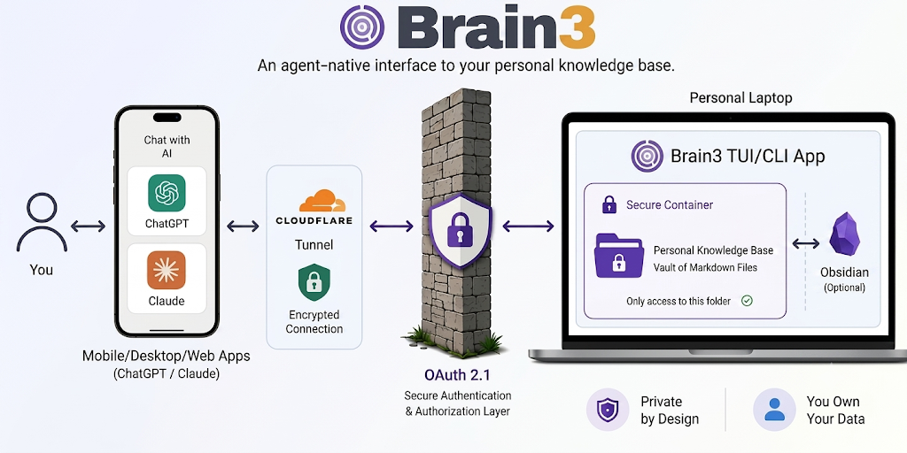
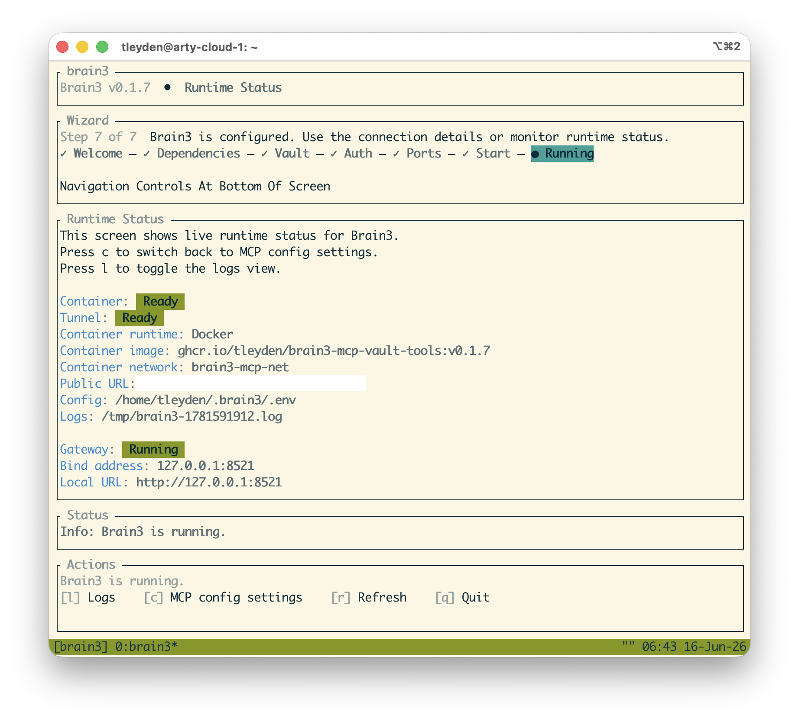
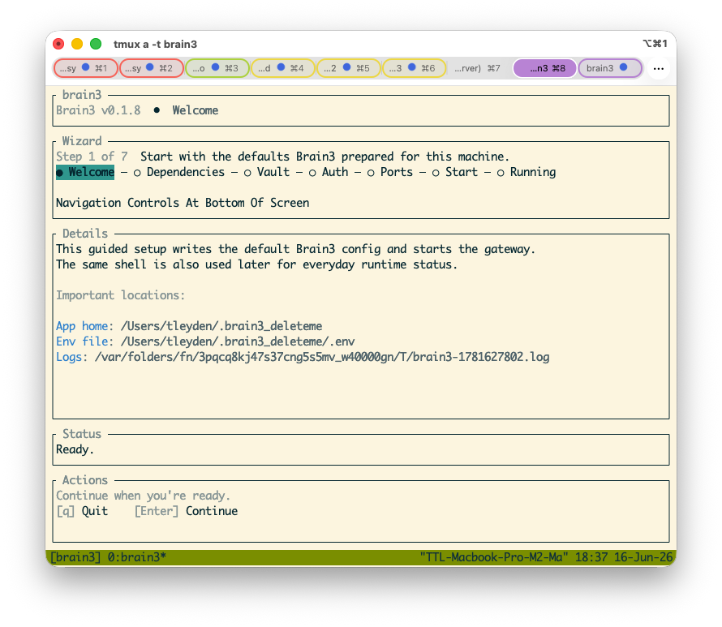
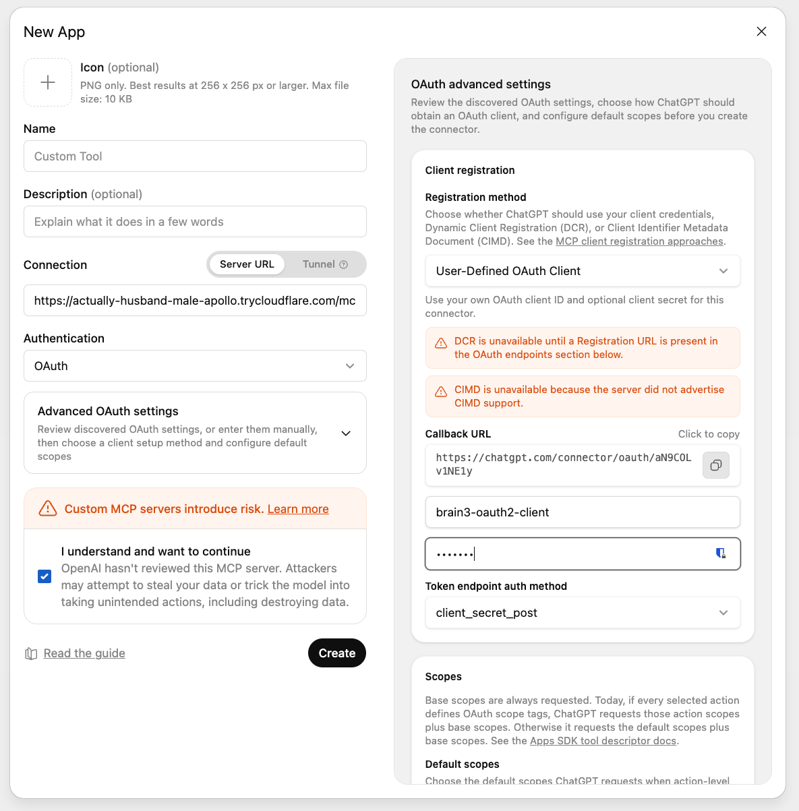
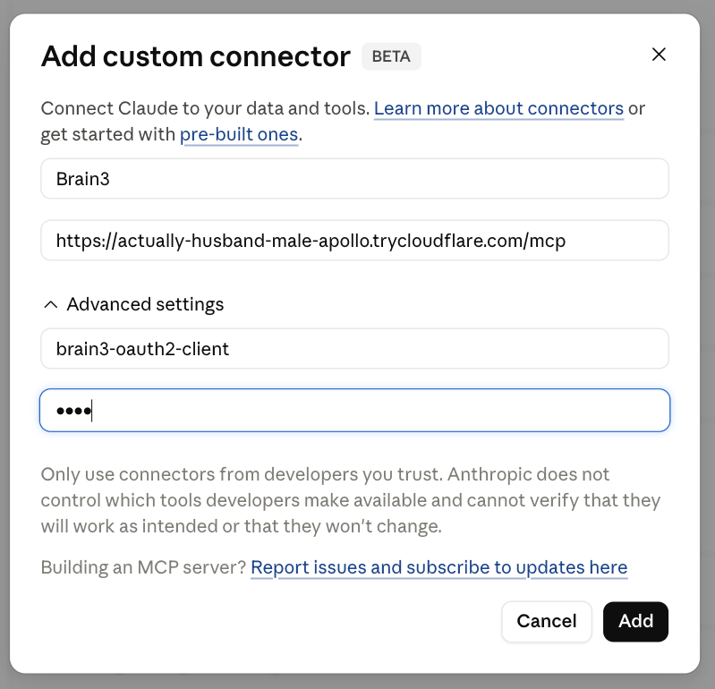
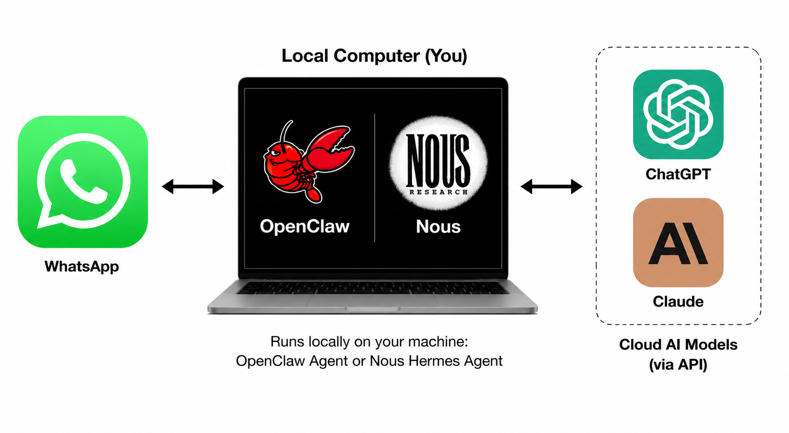
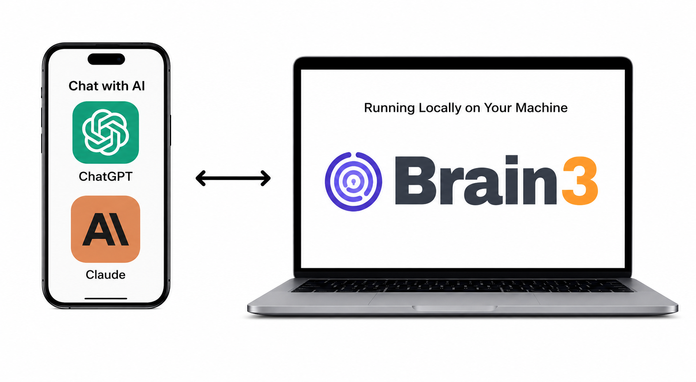

<p align="center">
    <a href="https://discord.gg/SPKtm5ACn"></a>
  <a href="https://scorecard.dev/viewer/?uri=github.com/tleyden/brain3"></a>
  <a href="https://mcpsafe.io/scan/pubfast7d6fa5a2c28d801f2a93"></a>
</p>

<br/>

<p align="center">
  
  <br/>
  Access and update your local markdown vault via an AI interface 
  <br/>
  
</p>

Markdown vaults like Obsidian are extremely powerful, but:

1. **Copying and pasting content** between your AI and your markdowns is tedious. 
2. **Don't have a built-in summary and clean/up layer** to take your raw notes and clean them up.
2. **Don't provide AI-native voice dictation**  and instead rely on the OS level dictation, which often is not as good.
3. **Are difficult to edit on mobile** since the smaller screen makes things harder to see and copy/paste.

instead you can add AI as a new interface for your markdown vault:  

- **Pull in context directly** from your AI chats into your markdown vault, or vice versa: pull from your markdown files into your chats.  
- Use the AI for **summary and clean-up** to turn your raw thoughts into structured content.
- Use your AI's **built-in voice dictation** when you'd rather talk than type, and have it summarized or cleaned up however you specify.

You don't need to change anything about your markdown vault structure or storage, which stays local and private.

Comptible with Obsidian, including Obsidian Sync. LLMWiki + Open Knowledge Format (OKF) markdown vault support is on the roadmap.

<div align="center">

https://github.com/user-attachments/assets/9c58b146-a874-4faf-8e43-f6b7f7f48e75

<em>Sample Weekly Planning Session With ChatGPT and Brain3</em>

</div>

## Use Cases

All the same use cases you'd typically use a note-taking app for, like:

1. Weekly and daily planning, make the AI your planning assistant.
2. Jot down quick notes and ideas in an "inbox" folder.
3. etc..

## Screenshots - Admin Terminal UI (TUI)

<a href="docs/screenshots/tui_screenshot.png">
  
</a>


## Quick Start

> [!CAUTION]
> Brain3 is still in alpha. Make sure you have backup copies or version control of your vault data before running this on sensitive data. If you enable remote MCP the service will be reachable from the internet while it's running, and any errors in the OAuth flow could potentially expose your data. See [Privacy & Security](#privacy--security) for more details. 

### Install Prerequisites

####  macOS

- Container runtime: `brew install container && brew services start container`
- Cloudflare Tunnel (optional, for remote MCP): `brew install cloudflared`

macOS container is recommended, but you can also use [Docker Desktop for Mac](https://docs.docker.com/desktop/setup/install/mac-install/)

####  Linux

<details>
<summary>Ubuntu/Debian install commands</summary>

```bash
# Docker
sudo apt update
sudo apt install ca-certificates curl
sudo install -m 0755 -d /etc/apt/keyrings
sudo curl -fsSL https://download.docker.com/linux/ubuntu/gpg -o /etc/apt/keyrings/docker.asc
sudo chmod a+r /etc/apt/keyrings/docker.asc
sudo tee /etc/apt/sources.list.d/docker.sources <<'EOF'
Types: deb
URIs: https://download.docker.com/linux/ubuntu
Suites: $(. /etc/os-release && echo "${UBUNTU_CODENAME:-$VERSION_CODENAME}")
Components: stable
Architectures: $(dpkg --print-architecture)
Signed-By: /etc/apt/keyrings/docker.asc
EOF
sudo apt update
sudo apt install docker-ce docker-ce-cli containerd.io docker-buildx-plugin docker-compose-plugin

# cloudflared
sudo mkdir -p --mode=0755 /usr/share/keyrings
curl -fsSL https://pkg.cloudflare.com/cloudflare-main.gpg | sudo tee /usr/share/keyrings/cloudflare-main.gpg >/dev/null
echo 'deb [signed-by=/usr/share/keyrings/cloudflare-main.gpg] https://pkg.cloudflare.com/cloudflared any main' | sudo tee /etc/apt/sources.list.d/cloudflared.list
sudo apt-get update
sudo apt-get install cloudflared
```
</details>

#### Windows

- Container runtime: [Docker Desktop for Windows](https://docs.docker.com/desktop/setup/install/windows-install/)
- Cloudflare Tunnel (optional, for remote MCP): install `cloudflared` manually with `winget`, Chocolatey, or the Cloudflare download page, and make sure it is on `PATH`

Windows release artifacts are published for the `x86_64-pc-windows-msvc` target. Windows builds are available but have not been tested yet. First-run cloudflared auto-install is not implemented on Windows yet.

### Install and run Brain3

On macOS or Linux, install with:

```bash
curl -sSfL https://brain3.s3.amazonaws.com/releases/v0.2.12/install.sh | sh
```

For Windows, download and extract the Windows artifact:

```powershell
curl.exe -L -o brain3-x86_64-pc-windows-msvc.tar.gz https://brain3.s3.amazonaws.com/releases/latest/brain3-x86_64-pc-windows-msvc.tar.gz
tar -xzf brain3-x86_64-pc-windows-msvc.tar.gz
.\brain3.exe
```

Run `brain3`:

```bash
brain3
```

It should launch an interactive setup wizard.

<a href="docs/screenshots/SetupWizardScreenshot.png">
  
</a>

For an existing install, run `brain3 --setup` to review and change current settings, including enabling audio transcription on installs created before that option existed.

#### What the setup wizard will ask

The vault path is the only required decision. The other steps have defaults you can keep unless your setup needs something different; see the [Configuration Reference](#configuration-reference) for the full list.

- **Vault Path** — enter the absolute path to your Obsidian vault. It must already exist.
- **Local/Remote Access** — choose Local MCP only, Remote MCP only, or Both.
- **Auth Setup** — choose the username (`admin`) and client ID (`brain3-oauth2-client`). The password is auto-generated; press `g` to enter a custom one.
- **Network Security** — review ports, container name, token lifetimes, PKCE, hostname checks, and container networking.
- **Audio Transcription** — enable the native `transcribe_audio_file` MCP tool and choose the Whisper model Brain3 should download and checksum-verify.

### Start at boot on Linux

Run Brain3 and its named Cloudflare Tunnel as separate systemd services. Brain3
listens on loopback and Cloudflare forwards the public hostname to its OAuth gateway.
Both services start before you log in.

#### Prepare the Brain3 account

Install Docker Engine and `cloudflared` using your distribution's packages (see
the Linux install commands above). Complete the Brain3 setup wizard as the
account that will run the service, or reuse that account's existing installation.
As that account, run `command -v brain3 docker cloudflared` and `docker info`.
Check that the account can access the vault and read and write its Brain3 app
directory at boot. [Membership in the `docker` group grants root-level privileges.](https://docs.docker.com/engine/install/linux-postinstall/#manage-docker-as-a-non-root-user)

Back up the existing `.env` privately and set these values before switching to
the external tunnel. Keep the existing vault path, gateway port, credentials,
and token database. Use absolute paths for any path settings in `.env`.

| Setting | Value for a systemd-managed tunnel |
|---|---|
| `B3_ACCESS_MODE` | Keep `both` if you also use local MCP, or use `remote` for OAuth only |
| `B3_CF_QUICK_TUNNEL` | `false` |
| `B3_CF_TUNNEL_NAME` | Remove or leave empty |
| `B3_CF_DOMAIN` | Remove or leave empty |
| `B3_CF_TUNNEL_CONFIG_FILE` | Remove or leave empty |
| `B3_DIRECT_PUBLIC_ORIGIN_HOSTNAME` | Your tunnel hostname, such as `brain3.example.com`, without a scheme or path |
| `B3_OAUTH2_GATEWAY_ENFORCE_HOSTNAME_CHECK` | `true` |

#### Install the Brain3 unit

Save the following as `/etc/systemd/system/brain3.service` with `sudoedit`.
Replace `brain3user`, its home and working directory, the executable path, and
the Brain3 app home with values for your installation. For a migration, use
the existing Brain3 working directory and app home.

<!-- brain3.service -->
```ini
[Unit]
Description=Brain3 MCP gateway
Requires=docker.service
Wants=network-online.target
After=docker.service network-online.target
StartLimitIntervalSec=300
StartLimitBurst=5

[Service]
Type=exec
User=brain3user
WorkingDirectory=/home/brain3user
Environment=HOME=/home/brain3user
Environment=PATH=/usr/local/sbin:/usr/local/bin:/usr/sbin:/usr/bin:/sbin:/bin
ExecStart=/home/brain3user/.local/bin/brain3 --cli --host 127.0.0.1 --brain3-home /home/brain3user/.brain3
KillSignal=SIGINT
KillMode=mixed
TimeoutStopSec=60s
Restart=on-failure
RestartSec=10s
StandardOutput=journal
StandardError=journal

[Install]
WantedBy=multi-user.target
```

`Type=exec` reports failures to launch the binary. Upstream systemd added it in
version 240. Use `Type=simple` if your system does not support `exec`. If the
vault or app home is on a separate mount,
add `RequiresMountsFor=/absolute/path/to/mount` under `[Unit]`. If pulls fail
only at boot, check DNS and whether your distribution's network wait service
is enabled. `cloudflared` must be on the unit's `PATH` for Brain3's dependency
check.

Brain3 reads `.env` from the configured app home. For a custom location, add
`--env-file /etc/brain3/brain3.env` to `ExecStart`, and make that file readable
by the service user only (mode `0600`). Keep credentials in that file or the
existing `.env` and keep the unit limited to paths and other nonsecret settings.

For a migration, stop the existing Brain3 process with Ctrl-C and wait for it
to exit before starting the unit. Run these commands and replace the example
hostname and port in the probe with your own values.

```bash
sudo systemd-analyze verify /etc/systemd/system/brain3.service
sudo systemctl daemon-reload
sudo systemctl start brain3.service
curl -fsS -H 'Host: brain3.example.com' -H 'X-Forwarded-Proto: https' \
  http://127.0.0.1:2763/.well-known/oauth-protected-resource/mcp
```

Once the probe returns the expected HTTPS resource and authorization server,
run `sudo systemctl enable brain3.service`. `active` alone only confirms that
the process started.

#### Run the named tunnel as a service

Check `systemctl cat cloudflared.service` before staging tunnel files. If it
already runs this tunnel, reuse the unit and its configuration. If it runs a
different tunnel, preserve its configuration and use a dedicated unit such as
`cloudflared-brain3.service` with its own config and credential paths.

For a new named tunnel, follow [Cloudflare's local tunnel setup](https://developers.cloudflare.com/tunnel/features/locally-managed-tunnels/create-local-tunnel/)
to create the tunnel and DNS route. For an existing tunnel, reuse its UUID,
credential JSON, and DNS route. For a fresh `cloudflared.service`, place its
configuration at `/etc/cloudflared/config.yml`. Use the absolute
`credentials-file` path and set the credential JSON to mode `0600`, owned by
the account running the tunnel (root with the stock unit). Route the whole
hostname to the loopback OAuth port so MCP and OAuth discovery share the same
public origin.

```yaml
tunnel: REPLACE_WITH_TUNNEL_UUID
credentials-file: /etc/cloudflared/REPLACE_WITH_TUNNEL_UUID.json
ingress:
  - hostname: brain3.example.com
    service: http://127.0.0.1:2763
  - service: http_status:404
```

With Brain3 ready and no existing `cloudflared.service`, validate and install the
unit using [Cloudflare's Linux service instructions](https://developers.cloudflare.com/tunnel/features/locally-managed-tunnels/as-a-service/linux/).

```bash
sudo cloudflared --config /etc/cloudflared/config.yml tunnel ingress validate
sudo cloudflared --config /etc/cloudflared/config.yml service install
sudo systemctl enable --now cloudflared.service
```

If you need a dedicated unit, put the tunnel configuration in
`/etc/cloudflared/brain3.yml` and validate that path with `tunnel ingress validate`.
Save this example as `/etc/systemd/system/cloudflared-brain3.service` and adjust
the packaged executable path if needed.

```ini
[Unit]
Description=Cloudflare Tunnel for Brain3
Wants=network-online.target
After=network-online.target

[Service]
ExecStart=/usr/bin/cloudflared --no-autoupdate --config /etc/cloudflared/brain3.yml tunnel run
Restart=on-failure
RestartSec=10s

[Install]
WantedBy=multi-user.target
```

For the dedicated unit, run `sudo systemctl daemon-reload` and
`sudo systemctl enable --now cloudflared-brain3.service`. Use that unit name in
the checks below.

```bash
systemctl is-active brain3.service cloudflared.service
systemctl is-enabled brain3.service cloudflared.service
curl -fsS https://brain3.example.com/.well-known/oauth-authorization-server
```

Confirm discovery advertises the public HTTPS hostname, then connect with your
configured MCP client to verify OAuth sign-in and MCP initialization.

#### Operate and recover the services

```bash
systemctl status brain3.service cloudflared.service
sudo journalctl -b -u brain3.service -u cloudflared.service
sudo systemctl restart brain3.service
sudo systemctl disable --now brain3.service
```

Manage a dedicated tunnel separately with `systemctl restart` or
`systemctl disable --now` on its unit. Leave a shared tunnel running for its
other routes. For Brain3 upgrades, use the signed installer with `INSTALL_DIR`
set to the directory in `ExecStart`, then restart Brain3. For changes that need
the TUI, stop the service, run `brain3 --setup` as the service user with the
same app home and config flags, quit it cleanly, and restart the service.

After a crash or interrupted startup, Brain3 refuses to start if it finds a
managed vault container orphan for the same installation. Review the journal
and stop `brain3.service`. As the service user, run its `ExecStart` command from
the same working directory with `--gc-containers` appended for that run. Wait
for startup and quit with Ctrl-C. If systemd hit its start limit, run
`sudo systemctl reset-failed brain3.service`, then start the service normally.

### Configure your AI 

#### Compatibility Matrix

| AI Client | Local MCP | Remote MCP |
|-----------|-----------|------------|
|  ChatGPT | ✅ (untested) | ✅ |
|  Claude | ✅ (untested) | ✅ |
|  Jan.ai | ✅ | ❌ (blocked on https://github.com/janhq/jan/issues/6353) |
|  Goose | ✅ | ❌ (blocked on https://github.com/aaif-goose/goose/issues/8918) |

In the Brain3 TUI, press `c` to open **MCP Config Settings**.

Brain3 displays all the connection information you need. Follow the instructions below for your AI client.

<details>
<summary> <strong>ChatGPT — GUI + Remote MCP</strong></summary>

<a href="docs/screenshots/ChatGPTConfig.png">
  
</a>

1. Open **Settings → Connectors → Create Connector**.
2. Select **Custom MCP Server**.
3. Copy the **Server URL**, **Client ID**, and **Client Secret** from Brain3's MCP Config Settings screen.
4. Complete the OAuth authorization flow when prompted.
5. When shown a login screen, enter the **Username** and **Password** displayed in Brain3's MCP Config Settings screen.

Once authorization succeeds, Brain3 will be available as a connector in ChatGPT.

</details>

<details>
<summary> <strong>ChatGPT — JSON Config + Local MCP (untested)</strong></summary>

The ChatGPT macOS desktop client does not expose a configuration file on disk; you must link your local server using the internal **Developer Mode** layout.

#### Step 1: Enable Developer Mode

1. Launch ChatGPT Desktop on your Mac.
2. Open Settings by pressing **Cmd + ,** (or click your profile icon → **Settings**).
3. Select **Apps & Connectors** (or **Connected Apps**) from the sidebar.
4. Scroll to the bottom, expand **Advanced Settings**, and toggle **Developer Mode** to **ON**.

#### Step 2: Add Custom App Connector

1. Click the **Create** button next to your Developer Mode options.
2. Fill out the registration form:
   - **Name:** `Brain3`
   - **Connector URL:** Copy the **Local MCP Endpoint** from Brain3's MCP Config Settings screen (e.g. `http://localhost:2764/mcp`)

#### Step 3: Configure Direct Bearer Authentication

1. Find the **Authentication** dropdown in the app configuration pane.
2. Select **Custom Headers** (or **API Key / Token** depending on your build version).
3. Provide the key-value pair:
   - **Key:** `Authorization`
   - **Value:** `Bearer <token from Brain3's MCP Config Settings screen>`
4. Click **Save** or **Create**.

> **macOS Sandboxing Note:** If ChatGPT blocks the connection because it is unencrypted `http://` rather than `https://`, you may need to expose the local port via a loopback TLS tunnel such as `ngrok http 2764` and use the resulting `https://` URL instead.

</details>

<details>
<summary> <strong>Claude — GUI + Remote MCP</strong></summary>

<a href="docs/screenshots/ClaudeConfig.png">
  
</a>

1. Open **Settings → Connectors → Add Custom Connector**.
2. Enter the **Server URL** shown in Brain3.
3. If prompted, enter the **Client ID** and **Client Secret** from the MCP Config Settings screen.
4. Complete the OAuth authorization flow.
5. When shown a login screen, enter the **Username** and **Password** displayed in Brain3's MCP Config Settings screen.

Once authorization succeeds, Brain3 will appear as a custom connector in Claude.

</details>

<details>
<summary> <strong>Claude — JSON Config + Local MCP (untested)</strong></summary>

Claude Desktop on macOS natively supports the `streamable-http` / `http` protocol directly in its configuration file.

#### Step 1: Open the Config File

```bash
open ~/Library/Application\ Support/Claude/claude_desktop_config.json
```

Or open it in your editor of choice.

#### Step 2: Add the Brain3 MCP Server

Paste or merge the following block into your JSON. Copy the endpoint URL and token from Brain3's MCP Config Settings screen:

```json
{
  "mcpServers": {
    "brain3": {
      "type": "http",
      "url": "http://localhost:2764/mcp",
      "headers": {
        "Authorization": "Bearer <token from Brain3's MCP Config Settings screen>"
      }
    }
  }
}
```

#### Step 3: Restart Claude Desktop

Quit Claude Desktop entirely (**Cmd + Q**), then relaunch it. Check the plug icon in the lower-right corner of the chat input to confirm Brain3 tools appear.

</details>

<details>
<summary> <strong>Goose — GUI + Local MCP</strong></summary>

1. Open Goose settings and navigate to **MCP → Add Server**.
2. Set the **URL** to the **Local MCP Endpoint** shown in Brain3's MCP Config Settings screen (e.g. `http://localhost:2764/mcp`).
3. Under **Request Headers**, add:
   - **Header name:** `Authorization`
   - **Value:** `Bearer <token from Brain3's MCP Config Settings screen>`
4. Save and restart Goose if prompted.

</details>

<details>
<summary> <strong>Jan.ai — GUI + Local MCP</strong></summary>

1. Open Jan, go to **Settings → MCP Servers → Add Server**.
2. Set the **URL** to the **Local MCP Endpoint** shown in Brain3's MCP Config Settings screen (e.g. `http://localhost:2764/mcp`).
3. Add a request header:
   - **Header name:** `Authorization`
   - **Value:** `Bearer <token from Brain3's MCP Config Settings screen>`
4. Save and reload Jan if prompted.

</details>

Now you're ready to access your markdown vault through your AI.

## Roadmap

* Improve search accuracy — currently full-text keyword search with no fuzzy or semantic matching, so exact terms work best.
* Add [LLMWiki](https://gist.github.com/karpathy/442a6bf555914893e9891c11519de94f) features to auto-summarize, organize, and improve search based on [Astro-Han/karpathy-llm-wiki](https://github.com/Astro-Han/karpathy-llm-wiki)
* NotebookLM features
* Desktop menu bar app with full system tray integration + GUI
* Support alternative tunneling options such as Tailscale and ngrok

## Comparing overall design vs. OpenClaw & Hermes

While both [OpenClaw](https://github.com/openclaw/openclaw) and [Hermes Agent](https://github.com/nousresearch/hermes-agent) also make it easy to chat with your markdown vault, there is a fundamental difference in architecture and cost model.

**OpenClaw and Hermes Agent**



Routes your AI through a messaging app to reach local resources, often requiring direct API key use rather than subscription billing, which can get costly.

<details>
<summary>OpenClaw/Hermes Pros and Cons</summary>

| ✅ Pros | 🔴 Cons |
|------|------|
| Can access local resources | Anthropic does not allow subscription use with OpenClaw, and direct AI API key use can get extremely costly |
| Plugin system | Inconsistent user interfaces, for example WhatsApp does not have native AI transcription and relies on OS |
| No direct internet access to laptop — only indirect access via chat apps like WhatsApp | Most messaging apps don't support token streaming, so you need to wait for the full response |
| Local memories, with the agent able to update its own notes over time | If you start conversations in a native AI app, you have to then switch to your messaging app to chat with your agent |

</details>

**Brain3**



Connects your vault directly to your AI via MCP, works with your existing Claude or ChatGPT subscription, and you never leave your native AI app.

<details>
<summary>Brain3 Pros and Cons</summary>

| ✅ Pros | 🔴 Cons |
|------|------|
| Works with subscription billing, not just API keys | Remote MCP requires a publicly accessible network endpoint (e.g. Cloudflare tunnel); local MCP (e.g. Claude Code) works without a tunnel |
| AI-native voice transcription (STT) and playback (TTS) | Potentially higher round-trip latency, especially with multiple tool calls |
| Will immediately work when real-time voice conversation is enabled for MCP | For certain tasks, an additional local agent might be required, increasing latency further |
| No need to leave the app context you're already in | More limited by the MCP interface, whereas OpenClaw and Hermes can basically do anything you imagine |
| Portable across any AI that supports the MCP standard | |

</details>

## Advanced Configuration Options

On Linux, [start Brain3 at boot with systemd](#start-at-boot-on-linux). To keep a
manual session running after your shell exits, use a tool like
[tmux](https://github.com/tmux/tmux/wiki).

<details>
<summary> Named Cloudflare Tunnel on your domain (recommended)</summary>

Recommended if you want a stable hostname like `brain3.yourdomain.com`. This requires a Cloudflare account and a custom domain you control.

Named tunnels are also known to be more reliable and less likely to suffer rate limits or connectivity restrictions than quick tunnels, since quick tunnels are available to anyone without a Cloudflare account and may be throttled accordingly. 

Brain3's normal first-run setup configures the app and defaults to a Cloudflare quick tunnel. Named tunnel provisioning is a separate guided flow:

1. Run `brain3` once and complete the normal interactive setup wizard.
2. Create a (free) Cloudflare account at [cloudflare.com](https://cloudflare.com)
3. Install `cloudflared` if it is not already available — see [install instructions](https://developers.cloudflare.com/cloudflare-one/connections/connect-networks/downloads/)
4. In `~/.brain3/.env`, set `B3_CF_QUICK_TUNNEL=false`, `B3_CF_TUNNEL_NAME`, and `B3_CF_DOMAIN`. Brain3 uses `~/.brain3/cloudflared/<tunnel-name>.yml` unless you set `B3_CF_TUNNEL_CONFIG_FILE`.
5. Run the named tunnel provisioning wizard:

```bash
brain3 --cloudflare-setup
```

6. The wizard verifies `cloudflared`, handles login if needed, creates or reuses the named tunnel, writes the config file, and configures the DNS route.
7. Start Brain3 normally with `brain3`. It will start `cloudflared` automatically and log:

```
INFO tunnel started url=https://brain3.yourdomain.com
```

</details>

<details>
<summary>Tunneling alternative: Direct public origin</summary>

This is an alternative to a Cloudflare Tunnel if tunnels are not practical in your environment. It is less preferred because it involves exposing ports more directly, so only use it when a Cloudflare Tunnel is not a workable option.

If your machine already has a public IP or sits behind Cloudflare proxy, use Caddy or nginx to terminate TLS and reverse-proxy to `127.0.0.1:2763`. Set `B3_DIRECT_PUBLIC_ORIGIN_HOSTNAME` in your `.env` to the public hostname; Brain3 uses it for hostname validation.

Example minimal Caddyfile:

```
brain3.yourdomain.com {
    reverse_proxy 127.0.0.1:2763
}
```

</details>

<details>
<summary>Experimental: Plugin MCP Containers</summary>

Plugin MCP Containers are unsupported and subject to change. They are configured
only by hand-editing `brain3.yaml` in your Brain3 home directory, usually
`~/.brain3/brain3.yaml`.

Today Brain3 reads only the `plugin_mcp_containers` section:

```yaml
plugin_mcp_containers:
  - name: hello_mcp
    platform: docker
    image: ghcr.io/example/hello-mcp
    tag: latest
    port: 8420
    network: hello-mcp-net
    host_directory: /Users/you/hello-mcp-data
    container_directory: /data
    network_isolation: false
    env:
      LOGFIRE_CONSOLE: "true"
      MCP_DEBUG_LEVEL: debug
    auth:
      type: bearer_token
      secret_file: /Users/you/.brain3/secrets/hello_mcp.token
      secret_mount_path: /run/secrets/mcp_bearer_token
```

`name` must use lowercase letters, digits, and underscores only. `network` is
required and names the Docker/`container` network the plugin joins. With network
isolation enabled, Brain3 automatically creates it as an internal-only network
with no outbound access if it does not exist. Containers on different plugin
networks cannot reach each other. To let a plugin reach its own sidecar, such as
Postgres, attach the sidecar to the same network name.

`network_isolation` is optional and defaults to `true`. Set it to `false` to
join the configured network without requiring it to be internal. Brain3 reuses
an existing network as-is, including one managed by another stack, or creates a
normal non-internal network when it does not exist. A non-internal network
restores outbound internet access from inside the container. When an existing
Docker network is internal, Brain3 also attaches the container to Docker's
default bridge so its published port and outbound path remain available without
modifying the configured network. This is required for `platform: docker`
plugins on macOS, where Docker Desktop cannot combine only internal networking
with host-reachable published ports. Use `network_isolation: false` there, or
switch to `platform: macos_container` if the plugin does not need outbound
egress.

`env` is optional and sets plain, non-secret environment variables on the
plugin container. Keys must be valid environment variable names; secrets belong
in `auth.secret_file`, not here.

Brain3 starts each configured Plugin MCP Container with one read-write host
directory mount, sends `Authorization: Bearer <token>` when `auth.type` is
`bearer_token`, and exposes its tools with a `{name}__` prefix.

</details>

## Privacy & Security

<details>
<summary>🔒 View Privacy & Security Details</summary>

### Remote MCP & Cloudflare Tunnels

Brain3 runs an MCP server on your own machine. It supports two access modes:

- **Local MCP** — local clients like Claude Code connect directly on a localhost port using a static bearer token. No tunnel, no OAuth required.
- **Remote MCP** — major AI apps like Claude and ChatGPT require remote MCP connectors to be publicly accessible on the internet via TLS + OAuth2.1/PKCE in order to be configured via their UI and accessible across all supported apps (web, mobile, desktop). A Cloudflare tunnel gives Brain3 a reachable TLS endpoint, and OAuth2.1/PKCE is used for auth, with a locally configured username and password.

- ⚠️ If you use remote MCP via a Cloudflare tunnel, you should only use Brain3 if you trust Cloudflare: Cloudflare owns the root TLS certs and has the ability to decrypt traffic. See their [Cloudflare Transparency Report - H2 2025](https://www.cloudflare.com/transparency/).
- Brain3 stops the tunnels it starts. A systemd-managed tunnel has its own service lifecycle.

### Security Audit and Known Security Risks

- Known potential security risks are listed in the [Known Security Risks](#known-security-risks) section below.
- There is a preliminary AI-based [security audit](SECURITY_AUDIT.md) available. If you are a security engineer and willing to volunteer some time, please reach out.

### Data Security

- Container isolation ensures that the **MCP server only sees the directory that you specify** in the config. The container bind-mount is the enforced path boundary — the MCP server cannot read files outside your vault directory, even if instructed to (e.g. a prompt asking it to read `../../../etc/passwd` will fail at the filesystem level).
- Your **vault is never uploaded** to any cloud service.

### Network layer security + Auth

- The container uses **internal-only networking by default** and cannot make outbound connections to the public internet.  
- When using a Cloudflare tunnel for remote MCP, your machine doesn't need a "hole poked in the firewall" since it uses **outbound-only Cloudflare tunnel connections**. However, that public Cloudflare endpoint does become an entry point to your system, and is fully dependent on the OAuth layer for security.
- It uses OAuth2.1 with PKCE to authenticate with the AI provider; only the client you configure can get tokens, there is **no open registration** as both Dynamic Client Registration (DCR) and Client ID Meta Documents (CIMD) are disabled.
- OAuth is built on `oxide-auth` rather than a fully hand-rolled implementation.
- Client secret is required at token exchange (`client_secret_post`).
- Auth codes are single-use and expire after 5 minutes.
- Every login issues a **fresh 256-bit access token** (1-hour lifetime by default), stored in a local SQLite database.
- **Refresh token rotation** — the refresh token is replaced on every use; the old token is immediately revoked.
- **Per-IP rate limiting** on credential endpoints: `POST /oauth/authorize` and `POST /oauth/token` are capped at 20 attempts per 15 minutes per IP. Cloudflare's `CF-Connecting-IP` header is used for accurate IP identification behind the tunnel.
- The gateway validates bearer tokens on `/mcp` and uses a separate shared secret when forwarding requests to the vault-tools container.
- **Host validation rejects unexpected hostnames** (HTTP 421) when a public hostname is configured. NOTE: this only works with Cloudflare tunnels associated with a DNS record, which is the recommended configuration.
- Constant-time comparison for secret and token value checks (secret *length* is not hidden — see [security audit](SECURITY_AUDIT.md) M-4).
- The macOS/Linux `install.sh` verifies downloaded release tarballs against a signed checksum manifest before extraction.

### Miscellaneous

- 🦀 The host process is written in Rust which avoids several classes of vulnerabilities, like buffer overflow attacks.
-  The MCP server running in the container uses the well-known FastMCP server framework. 
- You retain full control and can stop Brain3, disable the tunnel, or disconnect your AI app whenever you choose
- The full source code for both the Brain3 gateway and the MCP server is available on GitHub in this repo.

</details>

### Known Security Risks

- **Prompt injection** — not mitigated by Brain3; the MCP server has no egress and runs in an isolated container network, but be careful what directory you point it at or what is in your vault.

- **Container port exposure (macOS)** — it is not yet confirmed whether the mapped container port is accessible only to the gateway or to any local process, which could allow OAuth bypass from locally running malware that could discover the shared secret on the host filesystem.
- **No sandboxing for host gateway process** — the Rust gateway has ambient filesystem and network access; a compromised dependency has no jail to contain it (unlike the MCP container). See `docs/SECURITY_AUDIT_LATEST.md` §6.3.
- **Plaintext secret storage** — secrets saved to `~/.brain3/.env` have file permissions `0600`. Brain3 generates the upstream shared secret in memory unless you supply one in the config.
- **No hostname validation in default (quick tunnel) mode** — hostname validation (HTTP 421 on unexpected `Host` headers) only works with named Cloudflare tunnels tied to a DNS record. The default quick tunnel setup currently disables it entirely. 


### Reporting Security Issues

Found a vulnerability? [Report it privately](https://github.com/tleyden/brain3/security/advisories/new) — open the repo's Security tab and click **Report a vulnerability**. Please hold public disclosure until a patch is available.

## Configuration Reference

All configuration is via environment variables, loaded from a `.env` file.

<details>
<summary>Brain3 Environment Variables</summary>

| Variable | Default | Description |
|---|---|---|
| `B3_ACCESS_MODE` | `both` | Enable `local`, `remote`, or both MCP listeners |
| `B3_OAUTH2_GATEWAY_PORT` | `2763` | Port for the remote OAuth gateway |
| `B3_LOCAL_MCP_PORT` | `2764` when a local bearer token is set | Loopback port for local MCP clients |
| `LOCAL_GATEWAY_MCP_BEARER_TOKEN` | *(empty)* | Bearer token required by the local MCP listener |
| `B3_OAUTH2_GATEWAY_CLIENT_ID` | `brain3-oauth2-client` | OAuth client ID accepted by Brain3 |
| `B3_OAUTH2_GATEWAY_CLIENT_SECRET` | *(required)* | OAuth client secret required at token exchange |
| `B3_OAUTH2_ACCESS_TOKEN_LIFETIME_SECS` | `3600` | Lifetime of issued access tokens in seconds |
| `B3_TOKEN_DB_PATH` | `~/.brain3/brain3.db` | Optional override for the SQLite database path used for issued one-hour access tokens |
| `B3_OAUTH2_GATEWAY_MCP_UPSTREAM_URL` | *(auto-derived from `B3_CONTAINER_HOST_PORT`)* | URL of the upstream MCP server (developers only) |
| `B3_UPSTREAM_SHARED_SECRET` | *(generated at startup)* | Optional fixed secret for requests from the gateway to vault tools |
| `B3_OAUTH2_PKCE_REQUIRED` | `true` | Require PKCE for OAuth flow |
| `B3_USERNAME` | *(required)* | Login username for the Brain3 sign-in page |
| `B3_PASSWORD` | *(required)* | Login password for the Brain3 sign-in page |
| `B3_OAUTH2_GATEWAY_ENFORCE_HOSTNAME_CHECK` | `true` | Reject requests for unexpected hostnames |
| `B3_NATIVE_AUDIO_TRANSCRIPTION_ENABLED` | `false` | Enable the native `transcribe_audio_file` MCP tool. The tool runs in the gateway process, not the MCP container. |
| `B3_WHISPER_MODEL` | `base.en` | Whisper ggml model to use. Supported setup choices are `tiny.en`, `base.en`, `small.en`, and `medium.en`; files are stored in `~/.brain3/whisper-models/`. |
| `B3_WHISPER_MAX_AUDIO_BYTES` | `52428800` | Maximum audio download size accepted by `transcribe_audio_file`. This is supported as a `.env` setting and is not edited in the setup wizard. |
| `B3_CF_QUICK_TUNNEL` | `false` | Set to `true` to have Brain3 start a quick Cloudflare Tunnel on startup |
| `B3_CF_TUNNEL_NAME` | *(empty)* | Named Cloudflare Tunnel name; set with `B3_CF_DOMAIN` and then run `brain3 --cloudflare-setup` to provision it |
| `B3_CF_DOMAIN` | *(empty)* | Cloudflare zone domain (used with `B3_CF_TUNNEL_NAME`) |
| `B3_CF_TUNNEL_CONFIG_FILE` | `~/.brain3/cloudflared/<tunnel-name>.yml` | Optional path to the `cloudflared` config file written during named tunnel provisioning |
| `B3_DIRECT_PUBLIC_ORIGIN_HOSTNAME` | *(empty)* | Public hostname when using an externally managed tunnel or a reverse proxy such as Caddy or nginx |
| `B3_CONTAINER_RUNTIME` | *(empty = skip)* | `macos-container` or `docker`; if set, Brain3 starts the container on startup |
| `B3_VAULT_PATH` | *(required if runtime set)* | Absolute path to your Obsidian vault or markdown folder |
| `B3_CONTAINER_IMAGE_REPO` | `ghcr.io/tleyden/brain3-mcp-vault-tools` in the setup wizard | Image repository without a tag. Required when the runtime is set. |
| `B3_CONTAINER_IMAGE_TAG` | Brain3’s release tag | Image tag to use. Leave empty to match the Brain3 release. |
| `B3_CONTAINER_HOST_PORT` | `2765` | Host loopback port when the container uses port publishing |
| `B3_CONTAINER_MCP_PORT` | `2765` | Port where vault tools listens inside the container |
| `B3_CONTAINER_INTERNAL_NETWORK_ISOLATION` | `true` | Keep the managed MCP container on an internal-only network with no default outbound route. Set to `false` only as a compatibility fallback if Docker/macOS internal networking is broken on your VPS or runtime. |
| `B3_VAULT_MCP_LOG_LEVEL` | `INFO` | Log level forwarded to the MCP server running inside the container. Set to `TRACE` to log the full body of every request/response sent to and from the MCP server, for debugging. |

</details>


<details>
<summary>MD Vault MCP Tools</summary>

Once connected, your AI app has access to these vault tools:

| Tool | Description |
|---|---|
| `vault_read` | Read a file or line range. Returns a content hash for safe patching. |
| `vault_create_overwrite_file` | Create a new note or replace an existing one entirely. |
| `vault_apply_unified_diff` | Apply a unified diff to an existing file. Preferred for precise edits. |
| `vault_batch_frontmatter_update` | Update YAML frontmatter fields across one or more files. |
| `vault_search` | Full-text search across the vault. |
| `vault_search_frontmatter` | Search by frontmatter field values. |
| `vault_list` | List files and directories in the vault. |
| `vault_move` | Move or rename a file. |
| `vault_delete` | Delete a file. |
| `transcribe_audio_file` | Native audio transcription for uploaded audio file references. Runs in the gateway process; uses Metal acceleration on macOS and CPU inference on Linux. Windows support is not yet available. |

</details>

## Developers / Contributors

See the [Quick Start](#quick-start) prerequisites above before continuing.

<details>
<summary><strong>Linux prerequisites</strong></summary>

Brain3's native audio transcription dependency builds Whisper's C/C++ code and
bindings at compile time. Linux source builds need a C/C++ toolchain, CMake,
Clang, and `libclang`.

On Debian/Ubuntu systems:

```bash
sudo apt-get update
sudo apt-get install -y build-essential cmake clang libclang-dev
```

If `libclang` is installed in a non-standard location, set `LIBCLANG_PATH` to
the directory containing `libclang.so`.

</details>

<details>
<summary><strong>Clone and build from source</strong></summary>

```bash
git clone https://github.com/tleyden/brain3.git
cd brain3
cargo build --release
```

</details>

<details>
<summary><strong>Start Brain3</strong></summary>

```bash
./target/release/brain3
```

Brain3 launches the setup wizard on first run and goes straight to the runtime status screen on subsequent runs. Run `brain3 --setup` to review or change existing settings later, including native audio transcription. See [Quick Start](#quick-start) for the full flow.

</details>

### Rebuild the vault-tools image

From the root of the source checkout, use `--rebuild-container` to build vault tools and start Brain3 in the same shell. Complete Brain3 setup once before using this flag. For a staging installation, pass its Brain3 home directory.

```bash
./target/release/brain3 --rebuild-container --brain3-home "$HOME/.brain3_staging"
```

Brain3 calls the [vault-tools build script](brain3-mcp-vault-tools/scripts/build-container.sh) with the runtime from the staging configuration. It uses the resulting local image for that launch. A build failure or failed container startup stops the launch before the gateway and tunnel start. The build uses the local runtime’s layer cache. It needs no registry push or CI run.

<details>
<summary><strong>Running tests</strong></summary>

```bash
cargo test
```

</details>

<details>
<summary><strong>Running E2E tests</strong></summary>

E2E tests start a real Brain3 gateway against a locally-built Docker container.
They require Docker and are not run by default. The smoke wrapper builds the
local MCP container image first, then runs the test only if the build succeeds:

```bash
uv run scripts/e2e_smoke.py
```

Raw equivalent:

```bash
docker build \
  -f ./brain3-mcp-vault-tools/Containerfile \
  -t brain3-mcp-vault-tools:e2e-local \
  ./brain3-mcp-vault-tools && \
cargo test -p brain3 --test e2e_smoke --features e2e -- --nocapture
```

</details>

<details>
<summary><strong>Install a PR build</strong></summary>

PR build installer scripts are published at `https://brain3.s3.amazonaws.com/pr/<PR_NUMBER>/install.sh` while the PR is open. The script supports macOS and Linux.

```bash
curl -sSfL https://brain3.s3.amazonaws.com/pr/123/install.sh | sh
```

Replace `123` with the pull request number.

</details>

<details>
<summary>MCP container image selection</summary>

Fresh installs default to the release-matched MCP image `ghcr.io/tleyden/brain3-mcp-vault-tools:vX.Y.Z`, where `X.Y.Z` matches the Brain3 app version. Apple `container` on macOS and Docker on macOS or Linux use the same registry. Brain3 pulls the selected tag only when it is missing from that runtime’s local image store.

For a one-time tag override on the official image repository, pass `--container-tag`. For example, `brain3 --container-tag latest` selects the published `latest` tag. The configured `B3_CONTAINER_IMAGE_REPO` and `B3_CONTAINER_IMAGE_TAG` apply on later launches.

The runtime status screen reports whether the container is `Ready` or `Failed` after startup verification. A failed startup includes the failure summary and log path.

</details>


## Credits 

* [obsidian-web-mcp](https://github.com/jimprosser/obsidian-web-mcp) was the inspiration and contributed code to the MCP server layer. Brain3 extends it with container-based isolation and a gateway server rewritten in Rust for future Tauri2 compatibility.


## License 

Apache 2.0. See [LICENSE.MD](LICENSE.MD) and [NOTICE.MD](NOTICE.MD).
